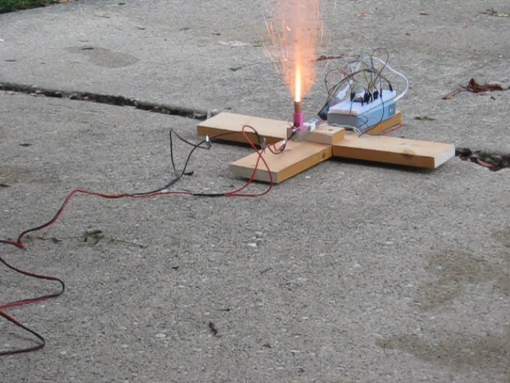

# Model Rocket Thrust Stand

This project is a thrust stand for an Estes A10-0T model rocket motor. I built this to see how closely a thrust curve from an at-home stand could resemble an official one from certified testers.

I used a cantilever load cell with custom 3D-printed mounting hardware, screwed into a wood base. The load cell passes analog data to an ADS1220 ADC breakout board, which communicates with an ESP32 microcontroller to stream data. The first two launches were recorded on an old Canon PowerShot and were time-synchronized via two quick taps. Weight calibration consisted of known weights measured with a kitchen scale, including a speaker, a case of drill bits, and a dumbbell that turned out to be a little over 10 lb.



Over four runs, I measured an average impulse of about 1.73 N·s over roughly 0.9 seconds. Three runs peaked around 9.9 N; the second peaked around 15.1 N. The mounting and calibration could have affected the readings, and I still need to explain the weak force tail and longer visible flame.

The [project write-up](https://lars.patkowa.com/projects/model-rocket-thrust-stand) has the wiring diagram, synchronized videos, all four plots, and a longer discussion of the results and sources of error.

## Files

- `esp32-thrust-stand/`: ESP32 firmware for the ADS1220 and Bluetooth/USB streaming.
- `Sources/ThrustStandStudio/`: a macOS app for reviewing a sensor trace alongside video, aligning the two, and fitting calibration points.
- `runs/`: the four launch windows and the two short videos used on my website. The CSVs contain the original raw counts and calibrated force for those windows. Their time starts at the beginning of each selected graph window. `website-graph.json` contains the reduced graph data used on the site.
- `scripts/`: video conversion and graph-overlay utilities.
- `docs/thrust-stand-studio.md`: the app's file format and workflow.

The full camera recordings, original captures, and earlier MCS workspace are kept locally and excluded from Git. The example clips and graph data are included. The app's examples cover the launch windows, so they don't include the earlier sections used to fit the original calibration.

## Build

The firmware uses PlatformIO:

```sh
cd esp32-thrust-stand
pio run
```

The app requires macOS 14 or later and Swift 6. From the project root:

```sh
swift run ThrustStandStudio
swift test
```

The app finds the `runs/` folder next to the project. It reviews recordings but does not capture new data from the stand. Its plots show raw counts; the website shows calibrated force. See the [app guide](docs/thrust-stand-studio.md) for sync and calibration instructions.
